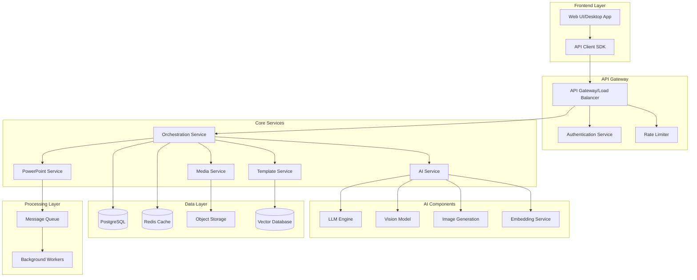

# Technical Architecture for Advanced PowerPoint AI Agent

## System Architecture Overview



## Microservices Architecture

### 1. Orchestration Service
**Purpose**: Central coordination of all services

```python
# orchestrator/service.py
from fastapi import FastAPI, HTTPException
from typing import Dict, Any
import asyncio

class OrchestrationService:
    def __init__(self):
        self.services = {
            'ai': AIServiceClient(),
            'powerpoint': PowerPointServiceClient(),
            'template': TemplateServiceClient(),
            'media': MediaServiceClient()
        }
        self.workflow_engine = WorkflowEngine()
    
    async def create_presentation(self, request: PresentationRequest) -> Dict[str, Any]:
        """Orchestrate presentation creation workflow"""
        workflow = self.workflow_engine.create_workflow([
            ('validate_request', self.validate_request),
            ('generate_outline', self.services['ai'].generate_outline),
            ('select_template', self.services['template'].select_best_template),
            ('generate_content', self.services['ai'].generate_content),
            ('process_media', self.services['media'].process_media),
            ('build_presentation', self.services['powerpoint'].build),
            ('quality_check', self.quality_check),
            ('finalize', self.finalize_presentation)
        ])
        
        result = await workflow.execute(request)
        return result
    
    async def validate_request(self, request: PresentationRequest):
        """Validate incoming request"""
        if not request.topic:
            raise ValueError("Topic is required")
        if request.num_slides < 1 or request.num_slides > 100:
            raise ValueError("Number of slides must be between 1 and 100")
        return request
    
    async def quality_check(self, presentation: Presentation):
        """Perform quality checks on generated presentation"""
        checks = [
            self.check_content_quality,
            self.check_design_consistency,
            self.check_accessibility,
            self.check_brand_compliance
        ]
        
        results = await asyncio.gather(*[check(presentation) for check in checks])
        
        if not all(results):
            # Attempt auto-fix
            presentation = await self.auto_fix_issues(presentation, results)
        
        return presentation
```

### 2. AI Service Architecture
**Purpose**: Handle all AI-related operations

```python
# ai_service/service.py
from typing import List, Dict, Any
import openai
from langchain.chains import LLMChain
from langchain.memory import ConversationBufferMemory

class AIService:
    def __init__(self):
        self.llm_engine = LLMEngine()
        self.vision_engine = VisionEngine()
        self.embedding_engine = EmbeddingEngine()
        self.prompt_manager = PromptManager()
    
    async def generate_outline(self, topic: str, requirements: Dict) -> Dict:
        """Generate presentation outline using AI"""
        prompt = self.prompt_manager.get_prompt('outline_generation')
        
        chain = LLMChain(
            llm=self.llm_engine.get_model('gpt-4'),
            prompt=prompt,
            memory=ConversationBufferMemory()
        )
        
        outline = await chain.arun(
            topic=topic,
            num_slides=requirements.get('num_slides', 10),
            style=requirements.get('style', 'professional'),
            audience=requirements.get('audience', 'general')
        )
        
        return self.parse_outline(outline)
    
    async def generate_content(self, outline: Dict, context: Dict) -> List[SlideContent]:
        """Generate detailed content for each slide"""
        slides = []
        
        for slide_outline in outline['slides']:
            content = await self.generate_slide_content(slide_outline, context)
            slides.append(content)
        
        return slides
    
    async def analyze_template(self, template_image: bytes) -> Dict:
        """Analyze template using vision model"""
        analysis = await self.vision_engine.analyze(
            image=template_image,
            prompt="""
            Analyze this PowerPoint template and extract:
            1. Color scheme (primary, secondary, accent colors)
            2. Font styles (headings, body text)
            3. Layout structure
            4. Design elements and patterns
            5. Visual hierarchy
            Return as structured JSON.
            """
        )
        
        return self.parse_template_analysis(analysis)
```

### 3. PowerPoint Service Architecture
**Purpose**: Handle PowerPoint file manipulation

```python
# powerpoint_service/service.py
import platform
from abc import ABC, abstractmethod
from typing import Optional

class PowerPointBackend(ABC):
    @abstractmethod
    async def create_presentation(self, content: Dict) -> bytes:
        pass
    
    @abstractmethod
    async def modify_presentation(self, file: bytes, modifications: Dict) -> bytes:
        pass

class COMBackend(PowerPointBackend):
    """Windows COM automation backend"""
    def __init__(self):
        if platform.system() != 'Windows':
            raise OSError("COM backend only available on Windows")
        import win32com.client
        self.powerpoint = win32com.client.Dispatch("PowerPoint.Application")
    
    async def create_presentation(self, content: Dict) -> bytes:
        presentation = self.powerpoint.Presentations.Add()
        # Implementation details...
        return self.save_to_bytes(presentation)

class PythonPPTXBackend(PowerPointBackend):
    """Cross-platform python-pptx backend"""
    def __init__(self):
        from pptx import Presentation
        self.Presentation = Presentation
    
    async def create_presentation(self, content: Dict) -> bytes:
        prs = self.Presentation()
        
        for slide_content in content['slides']:
            slide = self.add_slide(prs, slide_content)
            await self.populate_slide(slide, slide_content)
        
        return self.save_to_bytes(prs)

class CloudBackend(PowerPointBackend):
    """Microsoft Graph API backend"""
    def __init__(self, credentials: Dict):
        self.graph_client = GraphClient(credentials)
    
    async def create_presentation(self, content: Dict) -> bytes:
        # Create presentation using Graph API
        presentation_id = await self.graph_client.create_presentation()
        
        for slide_content in content['slides']:
            await self.graph_client.add_slide(presentation_id, slide_content)
        
        return await self.graph_client.download_presentation(presentation_id)

class PowerPointService:
    def __init__(self):
        self.backends = self._initialize_backends()
        self.current_backend = self._select_default_backend()
    
    def _initialize_backends(self) -> Dict[str, PowerPointBackend]:
        backends = {}
        
        # Try to initialize each backend
        try:
            backends['com'] = COMBackend()
        except:
            pass
        
        backends['pptx'] = PythonPPTXBackend()
        
        if self.has_cloud_credentials():
            backends['cloud'] = CloudBackend(self.get_cloud_credentials())
        
        return backends
    
    def _select_default_backend(self) -> PowerPointBackend:
        # Prioritize backends based on capabilities
        if 'com' in self.backends:
            return self.backends['com']
        elif 'cloud' in self.backends:
            return self.backends['cloud']
        else:
            return self.backends['pptx']
    
    async def create_presentation(self, content: Dict, backend: Optional[str] = None) -> bytes:
        """Create presentation using specified or default backend"""
        backend_instance = self.backends.get(backend) if backend else self.current_backend
        
        try:
            return await backend_instance.create_presentation(content)
        except Exception as e:
            # Fallback to alternative backend
            for name, backend in self.backends.items():
                if backend != backend_instance:
                    try:
                        return await backend.create_presentation(content)
                    except:
                        continue
            
            raise Exception(f"All backends failed: {e}")
```

### 4. Template Service Architecture
**Purpose**: Manage and process templates

```python
# template_service/service.py
from typing import List, Optional
import numpy as np
from sklearn.metrics.pairwise import cosine_similarity

class TemplateService:
    def __init__(self):
        self.storage = TemplateStorage()
        self.analyzer = TemplateAnalyzer()
        self.vector_db = VectorDatabase()
        self.customizer = TemplateCustomizer()
    
    async def upload_template(self, template_file: bytes, metadata: Dict) -> str:
        """Process and store user-uploaded template"""
        # Analyze template
        features = await self.analyzer.extract_features(template_file)
        
        # Generate embedding
        embedding = await self.generate_embedding(features)
        
        # Store template
        template_id = await self.storage.store(template_file, metadata)
        
        # Store in vector database
        await self.vector_db.insert(
            id=template_id,
            vector=embedding,
            metadata={**metadata, **features}
        )
        
        return template_id
    
    async def select_best_template(self, requirements: Dict) -> Template:
        """Select most suitable template based on requirements"""
        # Generate query embedding
        query_embedding = await self.generate_requirement_embedding(requirements)
        
        # Search similar templates
        candidates = await self.vector_db.search(
            vector=query_embedding,
            top_k=10
        )
        
        # Rank candidates based on additional criteria
        ranked = await self.rank_templates(candidates, requirements)
        
        # Load and return best template
        best_template_id = ranked[0]['id']
        return await self.storage.load(best_template_id)
    
    async def customize_template(self, template: Template, customizations: Dict) -> Template:
        """Apply customizations to template"""
        modified = template.copy()
        
        if 'colors' in customizations:
            modified = await self.customizer.apply_color_scheme(
                modified, 
                customizations['colors']
            )
        
        if 'fonts' in customizations:
            modified = await self.customizer.apply_fonts(
                modified,
                customizations['fonts']
            )
        
        if 'logo' in customizations:
            modified = await self.customizer.add_logo(
                modified,
                customizations['logo']
            )
        
        return modified
    
    async def generate_embedding(self, features: Dict) -> np.ndarray:
        """Generate embedding for template features"""
        # Combine different feature types
        text_features = f"{features.get('style', '')} {features.get('layout', '')}"
        color_features = features.get('colors', [])
        
        # Generate embeddings
        text_embedding = await self.get_text_embedding(text_features)
        color_embedding = self.encode_colors(color_features)
        
        # Combine embeddings
        combined = np.concatenate([text_embedding, color_embedding])
        
        return combined / np.linalg.norm(combined)
```

### 5. Media Service Architecture
**Purpose**: Handle media processing and generation

```python
# media_service/service.py
from PIL import Image
import io
from typing import Optional

class MediaService:
    def __init__(self):
        self.image_generator = ImageGenerator()
        self.image_processor = ImageProcessor()
        self.chart_generator = ChartGenerator()
        self.icon_library = IconLibrary()
        self.storage = MediaStorage()
    
    async def process_media_request(self, request: MediaRequest) -> MediaAsset:
        """Process media generation or retrieval request"""
        if request.type == 'image':
            return await self.handle_image_request(request)
        elif request.type == 'chart':
            return await self.handle_chart_request(request)
        elif request.type == 'icon':
            return await self.handle_icon_request(request)
        elif request.type == 'smartart':
            return await self.handle_smartart_request(request)
    
    async def handle_image_request(self, request: MediaRequest) -> MediaAsset:
        """Handle image generation or retrieval"""
        # Check cache first
        cached = await self.storage.get_cached(request.prompt)
        if cached:
            return cached
        
        # Try stock image search
        stock_image = await self.search_stock_images(request.prompt)
        if stock_image and request.allow_stock:
            processed = await self.image_processor.optimize(stock_image)
            return MediaAsset(type='image', data=processed, source='stock')
        
        # Generate with AI
        generated = await self.image_generator.generate(
            prompt=request.prompt,
            style=request.style,
            size=request.size
        )
        
        # Post-process
        processed = await self.image_processor.optimize(generated)
        
        # Cache result
        await self.storage.cache(request.prompt, processed)
        
        return MediaAsset(type='image', data=processed, source='ai_generated')
    
    async def handle_chart_request(self, request: MediaRequest) -> MediaAsset:
        """Generate charts and data visualizations"""
        chart = await self.chart_generator.create(
            data=request.data,
            chart_type=request.chart_type,
            style=request.style,
            colors=request.colors
        )
        
        # Convert to image
        chart_image = await self.chart_to_image(chart)
        
        return MediaAsset(type='chart', data=chart_image, metadata=chart.metadata)
```

## Data Models

```python
# models/presentation.py
from pydantic import BaseModel, Field
from typing import List, Optional, Dict, Any
from datetime import datetime
from enum import Enum

class PresentationStyle(str, Enum):
    PROFESSIONAL = "professional"
    CREATIVE = "creative"
    MINIMAL = "minimal"
    ACADEMIC = "academic"
    SALES = "sales"
    TECHNICAL = "technical"

class SlideLayout(str, Enum):
    TITLE = "title"
    TITLE_CONTENT = "title_content"
    TWO_COLUMN = "two_column"
    COMPARISON = "comparison"
    BLANK = "blank"
    SECTION_HEADER = "section_header"
    TITLE_ONLY = "title_only"
    CONTENT_WITH_CAPTION = "content_with_caption"

class MediaAsset(BaseModel):
    type: str
    url: Optional[str] = None
    data: Optional[bytes] = None
    alt_text: str
    metadata: Dict[str, Any] = {}

class SlideContent(BaseModel):
    title: str
    subtitle: Optional[str] = None
    body: Optional[List[str]] = None
    notes: Optional[str] = None
    layout: SlideLayout = SlideLayout.TITLE_CONTENT
    media: Optional[List[MediaAsset]] = None
    animations: Optional[List[Dict]] = None
    transitions: Optional[Dict] = None

class PresentationRequest(BaseModel):
    topic: str
    num_slides: int = Field(default=10, ge=1, le=100)
    style: PresentationStyle = PresentationStyle.PROFESSIONAL
    template_id: Optional[str] = None
    custom_template: Optional[bytes] = None
    audience: str = "general"
    language: str = "en"
    include_images: bool = True
    include_charts: bool = False
    brand_guidelines: Optional[Dict] = None
    additional_requirements: Optional[str] = None

class PresentationResponse(BaseModel):
    id: str
    status: str
    download_url: Optional[str] = None
    preview_url: Optional[str] = None
    created_at: datetime
    metadata: Dict[str, Any] = {}
    error: Optional[str] = None
```

## API Design

```python
# api/main.py
from fastapi import FastAPI, File, UploadFile, BackgroundTasks, HTTPException
from fastapi.responses import FileResponse
import uuid

app = FastAPI(title="PowerPoint AI Agent API")

@app.post("/api/v1/presentations", response_model=PresentationResponse)
async def create_presentation(
    request: PresentationRequest,
    background_tasks: BackgroundTasks
):
    """Create a new AI-powered presentation"""
    presentation_id = str(uuid.uuid4())
    
    # Start async processing
    background_tasks.add_task(
        process_presentation,
        presentation_id,
        request
    )
    
    return PresentationResponse(
        id=presentation_id,
        status="processing",
        created_at=datetime.now()
    )

@app.get("/api/v1/presentations/{presentation_id}")
async def get_presentation_status(presentation_id: str):
    """Get presentation generation status"""
    status = await get_status_from_cache(presentation_id)
    
    if not status:
        raise HTTPException(status_code=404, detail="Presentation not found")
    
    return status

@app.get("/api/v1/presentations/{presentation_id}/download")
async def download_presentation(presentation_id: str):
    """Download completed presentation"""
    file_path = await get_presentation_file(presentation_id)
    
    if not file_path:
        raise HTTPException(status_code=404, detail="Presentation not found or not ready")
    
    return FileResponse(
        file_path,
        media_type="application/vnd.openxmlformats-officedocument.presentationml.presentation",
        filename=f"presentation_{presentation_id}.pptx"
    )

@app.post("/api/v1/templates")
async def upload_template(
    file: UploadFile = File(...),
    name: str = None,
    description: str = None
):
    """Upload a custom template"""
    template_data = await file.read()
    
    template_id = await template_service.upload_template(
        template_data,
        metadata={
            'name': name or file.filename,
            'description': description,
            'uploaded_at': datetime.now()
        }
    )
    
    return {"template_id": template_id, "status": "uploaded"}

@app.post("/api/v1/presentations/{presentation_id}/slides")
async def add_slide(
    presentation_id: str,
    slide_content: SlideContent
):
    """Add a slide to existing presentation"""
    result = await powerpoint_service.add_slide(
        presentation_id,
        slide_content
    )
    
    return {"status": "added", "slide_number": result['slide_number']}

@app.put("/api/v1/presentations/{presentation_id}/slides/{slide_number}")
async def update_slide(
    presentation_id: str,
    slide_number: int,
    slide_content: SlideContent
):
    """Update existing slide"""
    result = await powerpoint_service.update_slide(
        presentation_id,
        slide_number,
        slide_content
    )
    
    return {"status": "updated", "slide_number": slide_number}

@app.websocket("/ws/presentations/{presentation_id}")
async def websocket_endpoint(websocket: WebSocket, presentation_id: str):
    """WebSocket for real-time updates"""
    await websocket.accept()
    
    try:
        while True:
            # Send progress updates
            progress = await get_progress(presentation_id)
            await websocket.send_json(progress)
            
            if progress['status'] in ['completed', 'failed']:
                break
            
            await asyncio.sleep(1)
    except WebSocketDisconnect:
        pass
```

## Database Schema

```sql
-- PostgreSQL schema
CREATE EXTENSION IF NOT EXISTS "uuid-ossp";
CREATE EXTENSION IF NOT EXISTS "vector";

-- Users table
CREATE TABLE users (
    id UUID PRIMARY KEY DEFAULT uuid_generate_v4(),
    email VARCHAR(255) UNIQUE NOT NULL,
    name VARCHAR(255),
    created_at TIMESTAMP DEFAULT CURRENT_TIMESTAMP,
    subscription_tier VARCHAR(50) DEFAULT 'free',
    api_key VARCHAR(255) UNIQUE
);

-- Presentations table
CREATE TABLE presentations (
    id UUID PRIMARY KEY DEFAULT uuid_generate_v4(),
    user_id UUID REFERENCES users(id),
    title VARCHAR(500),
    topic TEXT,
    status VARCHAR(50) DEFAULT 'pending',
    style VARCHAR(50),
    num_slides INTEGER,
    template_id UUID,
    file_path TEXT,
    created_at TIMESTAMP DEFAULT CURRENT_TIMESTAMP,
    updated_at TIMESTAMP DEFAULT CURRENT_TIMESTAMP,
    metadata JSONB
);

-- Templates table
CREATE TABLE templates (
    id UUID PRIMARY KEY DEFAULT uuid_generate_v4(),
    name VARCHAR(255),
    description TEXT,
    user_id UUID REFERENCES users(id),
    is_public BOOLEAN DEFAULT false,
    file_path TEXT,
    thumbnail_path TEXT,
    features JSONB,
    embedding vector(1536),
    usage_count INTEGER DEFAULT 0,
    created_at TIMESTAMP DEFAULT CURRENT_TIMESTAMP
);

-- Slides table
CREATE TABLE slides (
    id UUID PRIMARY KEY DEFAULT uuid_generate_v4(),
    presentation_id UUID REFERENCES presentations(id) ON DELETE CASCADE,
    slide_number INTEGER,
    title VARCHAR(500),
    content JSONB,
    layout VARCHAR(50),
    notes TEXT,
    created_at TIMESTAMP DEFAULT CURRENT_TIMESTAMP,
    UNIQUE(presentation_id, slide_number)
);

-- Media assets table
CREATE TABLE media_assets (
    id UUID PRIMARY KEY DEFAULT uuid_generate_v4(),
    presentation_id UUID REFERENCES presentations(id) ON DELETE CASCADE,
    slide_id UUID REFERENCES slides(id) ON DELETE CASCADE,
    type VARCHAR(50),
    url TEXT,
    file_path TEXT,
    prompt TEXT,
    metadata JSONB,
    created_at TIMESTAMP DEFAULT CURRENT_TIMESTAMP
);

-- Analytics table
CREATE TABLE analytics (
    id UUID PRIMARY KEY DEFAULT uuid_generate_v4(),
    user_id UUID REFERENCES users(id),
    presentation_id UUID REFERENCES presentations(id),
    event_type VARCHAR(100),
    event_data JSONB,
    created_at TIMESTAMP DEFAULT CURRENT_TIMESTAMP
);

-- Create indexes
CREATE INDEX idx_presentations_user_id ON presentations(user_id);
CREATE INDEX idx_presentations_status ON presentations(status);
CREATE INDEX idx_templates_embedding ON templates USING ivfflat (embedding vector_cosine_ops);
CREATE INDEX idx_templates_public ON templates(is_public);
CREATE INDEX idx_slides_presentation ON slides(presentation_id);
CREATE INDEX idx_media_presentation ON media_assets(presentation_id);
CREATE INDEX idx_analytics_user ON analytics(user_id);
CREATE INDEX idx_analytics_event ON analytics(event_type);
```

## Deployment Configuration

### Kubernetes Deployment

```yaml
# kubernetes/deployment.yaml
apiVersion: apps/v1
kind: Deployment
metadata:
  name: ppt-ai-agent
spec:
  replicas: 3
  selector:
    matchLabels:
      app: ppt-ai-agent
  template:
    metadata:
      labels:
        app: ppt-ai-agent
    spec:
      containers:
      - name: api
        image: ppt-ai-agent:latest
        ports:
        - containerPort: 8000
        env:
        - name: DATABASE_URL
          valueFrom:
            secretKeyRef:
              name: db-secret
              key: url
        - name: OPENAI_API_KEY
          valueFrom:
            secretKeyRef:
              name: ai-secret
              key: openai-key
        resources:
          requests:
            memory: "1Gi"
            cpu: "500m"
          limits:
            memory: "2Gi"
            cpu: "1000m"
        livenessProbe:
          httpGet:
            path: /health
            port: 8000
          initialDelaySeconds: 30
          periodSeconds: 10
        readinessProbe:
          httpGet:
            path: /ready
            port: 8000
          initialDelaySeconds: 5
          periodSeconds: 5
      
      - name: worker
        image: ppt-ai-agent-worker:latest
        env:
        - name: DATABASE_URL
          valueFrom:
            secretKeyRef:
              name: db-secret
              key: url
        - name: REDIS_URL
          valueFrom:
            secretKeyRef:
              name: redis-secret
              key: url
        resources:
          requests:
            memory: "2Gi"
            cpu: "1000m"
          limits:
            memory: "4Gi"
            cpu: "2000m"

---
apiVersion: v1
kind: Service
metadata:
  name: ppt-ai-agent-service
spec:
  selector:
    app: ppt-ai-agent
  ports:
  - port: 80
    targetPort: 8000
  type: LoadBalancer

---
apiVersion: autoscaling/v2
kind: HorizontalPodAutoscaler
metadata:
  name: ppt-ai-agent-hpa
spec:
  scaleTargetRef:
    apiVersion: apps/v1
    kind: Deployment
    name: ppt-ai-agent
  minReplicas: 2
  maxReplicas: 10
  metrics:
  - type: Resource
    resource:
      name: cpu
      target:
        type: Utilization
        averageUtilization: 70
  - type: Resource
    resource:
      name: memory
      target:
        type: Utilization
        averageUtilization: 80
```

### Docker Configuration

```dockerfile
# Dockerfile
FROM python:3.11-slim as builder

WORKDIR /app

# Install system dependencies
RUN apt-get update && apt-get install -y \
    gcc \
    g++ \
    && rm -rf /var/lib/apt/lists/*

# Install Python dependencies
COPY requirements.txt .
RUN pip install --no-cache-dir -r requirements.txt

FROM python:3.11-slim

WORKDIR /app

# Copy Python packages from builder
COPY --from=builder /usr/local/lib/python3.11/site-packages /usr/local/lib/python3.11/site-packages
COPY --from=builder /usr/local/bin /usr/local/bin

# Copy application code
COPY . .

# Create non-root user
RUN useradd -m -u 1000 appuser && chown -R appuser:appuser /app
USER appuser

# Health check
HEALTHCHECK --interval=30s --timeout=3s --start-period=5s --retries=3 \
  CMD python -c "import requests; requests.get('http://localhost:8000/health')"

EXPOSE 8000

CMD ["uvicorn", "api.main:app", "--host", "0.0.0.0", "--port", "8000"]
```

## Monitoring & Observability

```python
# monitoring/metrics.py
from prometheus_client import Counter, Histogram, Gauge
import time

# Define metrics
presentation_created = Counter(
    'presentations_created_total',
    'Total number of presentations created',
    ['style', 'template_type']
)

presentation_generation_time = Histogram(
    'presentation_generation_seconds',
    'Time taken to generate presentation',
    ['style', 'num_slides']
)

active_generations = Gauge(
    'active_presentation_generations',
    'Number of presentations currently being generated'
)

ai_api_calls = Counter(
    'ai_api_calls_total',
    'Total number of AI API calls',
    ['model', 'operation']
)

ai_api_latency = Histogram(
    'ai_api_latency_seconds',
    'AI API call latency',
    ['model', 'operation']
)

class MetricsCollector:
    @staticmethod
    def record_presentation_created(style: str, template_type: str):
        presentation_created.labels(style=style, template_type=template_type).inc()
    
    @staticmethod
    def record_generation_time(style: str, num_slides: int, duration: float):
        presentation_generation_time.labels(
            style=style,
            num_slides=str(num_slides)
        ).observe(duration)
    
    @staticmethod
    def track_active_generation():
        active_generations.inc()
        try:
            yield
        finally:
            active_generations.dec()
    
    @staticmethod
    def record_ai_call(model: str, operation: str, duration: float):
        ai_api_calls.labels(model=model, operation=operation).inc()
        ai_api_latency.labels(model=model, operation=operation).observe(duration)
```

## Security Implementation

```python
# security/auth.py
from fastapi import Security, HTTPException, status
from fastapi.security import HTTPBearer, HTTPAuthorizationCredentials
import jwt
from datetime import datetime, timedelta

class AuthHandler:
    security = HTTPBearer()
    secret = "YOUR_SECRET_KEY"
    algorithm = "HS256"
    
    def encode_token(self, user_id: str) -> str:
        payload = {
            'exp': datetime.utcnow() + timedelta(days=7),
            'iat': datetime.utcnow(),
            'sub': user_id
        }
        return jwt.encode(payload, self.secret, algorithm=self.algorithm)
    
    def decode_token(self, token: str) -> str:
        try:
            payload = jwt.decode(token, self.secret, algorithms=[self.algorithm])
            return payload['sub']
        except jwt.ExpiredSignatureError:
            raise HTTPException(
                status_code=status.HTTP_401_UNAUTHORIZED,
                detail='Token has expired'
            )
        except jwt.InvalidTokenError:
            raise HTTPException(
                status_code=status.HTTP_401_UNAUTHORIZED,
                detail='Invalid token'
            )
    
    def auth_wrapper(self, auth: HTTPAuthorizationCredentials = Security(security)):
        return self.decode_token(auth.credentials)

# Rate limiting
from slowapi import Limiter
from slowapi.util import get_remote_address

limiter = Limiter(key_func=get_remote_address)

@app.post("/api/v1/presentations")
@limiter.limit("10/minute")
async def create_presentation_with_limit(request: Request, presentation_request: PresentationRequest):
    # Implementation
    pass
```

## Performance Optimization

```python
# optimization/cache.py
import redis
import pickle
from functools import wraps
import hashlib

class CacheManager:
    def __init__(self):
        self.redis_client = redis.Redis(
            host='localhost',
            port=6379,
            decode_responses=False
        )
    
    def cache_key(self, *args, **kwargs):
        """Generate cache key from arguments"""
        key_data = str(args) + str(sorted(kwargs.items()))
        return hashlib.md5(key_data.encode()).hexdigest()
    
    def cache_result(self, ttl=3600):
        """Decorator for caching function results"""
        def decorator(func):
            @wraps(func)
            async def wrapper(*args, **kwargs):
                # Generate cache key
                key = f"{func.__name__}:{self.cache_key(*args, **kwargs)}"
                
                # Try to get from cache
                cached = self.redis_client.get(key)
                if cached:
                    return pickle.loads(cached)
                
                # Execute function
                result = await func(*args, **kwargs)
                
                # Store in cache
                self.redis_client.setex(
                    key,
                    ttl,
                    pickle.dumps(result)
                )
                
                return result
            return wrapper
        return decorator

# Usage
cache_manager = CacheManager()

@cache_manager.cache_result(ttl=7200)
async def generate_slide_content(topic: str, style: str) -> Dict:
    # Expensive AI operation
    return await ai_service.generate_content(topic, style)
```

This technical architecture provides a robust, scalable, and maintainable foundation for building the most advanced PowerPoint AI agent with all the features you specified.